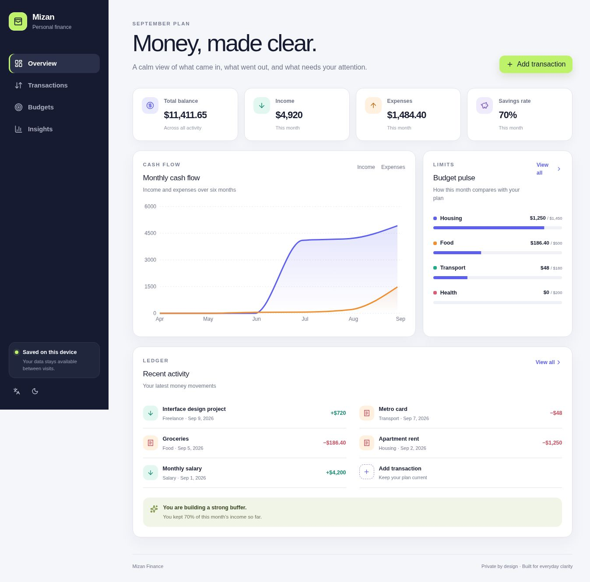
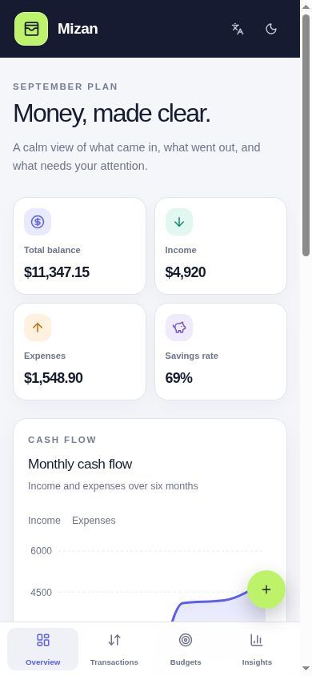

# Mizan Finance

Mizan is a bilingual, privacy-first personal finance planner built as a complete frontend application. It helps users record transactions, set category budgets, and understand spending patterns without connecting a bank account.

## Features

- Responsive dashboard for desktop, tablet, and mobile
- Transaction search, filtering, sorting, details, creation, editing, and deletion
- Validated transaction and budget forms with clear feedback
- Monthly category budgets and progress tracking
- Six-month cash-flow and category spending charts
- Persistent browser storage with loading, success, empty, and recoverable error states
- Installable PWA with offline app-shell caching
- English/Arabic localization with RTL support
- Light and dark themes
- Accessible semantics, labels, focus states, keyboard controls, and reduced-motion support
- JSON backup export and validated restore with replacement confirmation
- Monthly expense rules, with due entries added on app opening and month-end handling
- Automated behavior tests

## Routes

- `/` — financial overview
- `/transactions` — searchable transaction ledger
- `/budgets` — monthly category limits
- `/insights` — spending and cash-flow analysis
- Unknown routes — custom not-found state

## Project links

- Repository: https://github.com/rahman-997/mizan-finance
- Live demo: https://mizan-finance-rahman-997.netlify.app

## Run locally

Requirements: Node.js 22.13 or newer. The npm scripts are cross-platform and work in PowerShell, Command Prompt, macOS, and Linux.

```bash
npm ci
npm run dev
```

Open the local address shown in the terminal.

## Validate, test, and build

```bash
npm run lint
npm run typecheck
npm test
npm run build
npm run test:ui
```

Run the complete local quality gate with:

```bash
npm run ci
```

The core finance behavior tests are intentionally independent from the production build, while the UI contract tests run after `dist/` exists.

## Deploy to Cloudflare Workers

Authenticate Wrangler once with your Cloudflare account, then deploy with:

```bash
npm run deploy
```

The deploy command performs a verified production build first and then deploys the Cloudflare Worker output.

## Architecture

The application uses Next-compatible file routing through Vinext, React and TypeScript for the UI, React Context for shared finance data, local component state for filters and dialogs, Zod plus React Hook Form for validation, Recharts for data visualization, and browser storage for persistence. Pure calculation helpers live in `lib/finance-utils.mjs` and are exercised by Node's built-in test runner.

See [PROJECT_SUBMISSION.md](./PROJECT_SUBMISSION.md) for the complete product definition, AI prompts, architecture explanation, chosen feature rationale, and reflection answers.

## Screenshots

### Desktop



### Mobile



## Privacy

Mizan does not transmit financial entries to a server. User-created data remains in the current browser's local storage.

## Author

Designed and developed by **[Abdulrahman Hajar](https://github.com/rahman-997)** — Frontend Engineer and Full-Stack Developer in Istanbul, Türkiye.

## License

MIT

### Backup and monthly expenses
Use the upload icon beside Export to preview and restore a JSON backup (up to 5 MB). Existing exports remain supported. Restore replaces this browser’s entries and budgets only after confirmation and a successful local save. Export first to retain the current data.

The repeat icon manages monthly expense rules. These create local records, never payments. Due entries are generated when the app opens, up to 120 occurrences per rule per opening and 10,000 entries overall. Short months use their last day and the original day is retained for later months. Stopping a rule keeps previous entries.

### Browser regression checks
Run `npm ci`, `npx playwright install chromium`, then `npm run test:browser`.
The separate Node-based Vinext test server exercises device-local flows without
Cloudflare bindings; production configuration is unchanged. Tests cover Arabic
and English restore confirmation/cancellation, storage failure, entry/rule limits,
and toolbar viewport bounds at 320, 360, 390 and 768 px. These checks supplement
`npm run ci`; they do not replace visual inspection, keyboard/focus testing,
200% zoom, or mobile keyboard testing.


## Integrated V16 development build

The V16 dashboard and the previous backup/monthly-expense and read-only security work are **integrated only on the `feat/dashboard-v16` draft branch**. They are not part of the `main` branch or the public deployment until separately approved.

- Responsive blue-accented dashboard, with recorded income, expenses, balance and savings rate.
- A 6/12-month trend selector, categorized spending chart and budget progress.
- English and Arabic (RTL), dark/light appearance and an on-dashboard amount-hiding control.
- Validated local JSON backup restoration with an explicit replace confirmation; monthly recurring **records**, not payment instructions.
- Atomic in-memory finance updates that prevent repeated edits in one React render from dropping entries.
- Cross-tab write conflict detection: another tab's changes pause this tab's saves instead of silently overwriting them. Export this tab first if necessary, then use **Load latest records**.
- Read-only Semgrep security scan and Dependabot PRs with no automatic merging.

**Data handling:** Browser localStorage is not encrypted storage. Anyone with access to the same browser profile, its local data or an exported JSON backup may be able to read the finance records. This demo is not connected to banks or payment systems. Keep backups private, and do not depend on a single device as the only copy of important records.

### Verification

```bash
npm ci
npm run ci
npx playwright install chromium
npm run test:browser
```

The GitHub browser quality workflow additionally runs `node tests/dashboard-browser.mjs` to check real Chromium rendering at 320, 360, 390, 768 and 1280 pixels with both languages. Its screenshots and results are stored as workflow artifacts. No live deployment is required for these tests.

## PWA reliability and dependency gate (V16 draft)

The development branch adds a safer service worker and standard PNG icons (192px and 512px) for Android installation prompts. Navigations to the four known pages prefer a fresh network response and use the last cached page while offline. Static scripts, CSS, fonts and images are cached only from same-origin asset paths. API requests, authenticated requests, query-string URLs and private/no-store responses are not persisted by the worker. Missing JavaScript files now fail as offline assets rather than receiving the dashboard HTML.

**Offline limits:** The install precaches the four route documents and the manifest/favicon. JavaScript and other assets may require an online visit **after the service worker controls the page** to populate cache. First-launch offline use, complete Android device installation, browser updates and offline transaction editing have **not yet been verified end-to-end on a physical device**. Avoid relying on offline mode until that verification is complete.

Run service worker regression tests via `npm test`. GitHub CI runs `npm audit --omit=dev --audit-level=moderate` as a blocking check for production dependencies. Full `npm audit` is captured as an artifact for review and may still report development/build-tool advisories. The October 28, 2026 audit counted **14 advisories (6 high, 8 moderate, none critical)**; the production-dependency check passed, but the full audit was **not** clean. No automatic major-version fixes or production deployment are performed.


## V16 draft: savings goals and monthly reports

Two additional bilingual sections are available on the **development branch only**: `/goals` and `/reports`. Both appear in the desktop sidebar and six-item responsive mobile navigation. Neither section contacts a bank or initiates payments.

- **Savings goals:** Create up to 20 manually tracked targets, edit the amount you've set aside, review progress, or delete a goal with confirmation. Progress is a *manual planning figure*, not a real segregated account, and it never changes transaction balances. Goal updates use the existing multi-tab conflict protection.
- **Monthly reports:** Compare income, spending and net cash flow across the last 6 or 12 calendar months, with an accessible data table and aggregated CSV export. The report is based solely on recorded transactions. It is historical, not a financial forecast.
- **Backup compatibility:** JSON export version 3 includes goals. Restores accept versions 1, 2 and 3, including old backups without goals. New goal data is validated, constrained in size and shown in the restore preview before confirming replacement.
- **Offline behavior:** The service worker uses a newly versioned cache and pre-caches the new routes. As with other Mizan screens, assets should be warmed while connected before relying on offline reload. Chromium production tests cover the cold-offline navigation after warming the routes.

Please do not merge to `main` or deploy without explicit approval. Physical Android installation and accessibility testing on a real device remain separate release checks.
